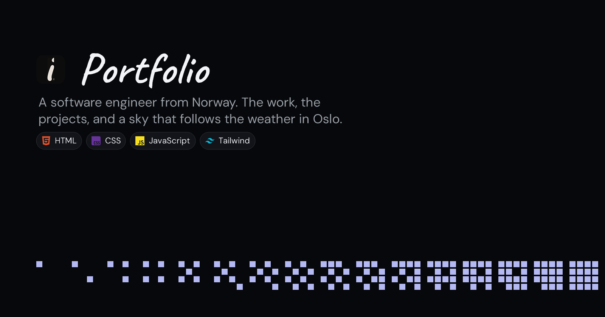

# Isaac



Software engineer in Oslo. I build trading tools and agentic pipelines for financial institutions.

I work as a full-stack engineer at Arctic Securities. Before that I was a software developer at Norges Bank Investment Management. I studied Informatics at the University of Oslo, and I have worked in security since I was 15.

## The site

This repository is my personal site. It is a static page: one HTML file, one stylesheet, and two scripts. There is no framework and no build step.

The layout is a single column. A dithered sky sits behind the header, then the journey, the projects, and an anime shelf. The older single-file version of the site is kept at `v1/index.html`, with a link back to the current page.

## How it is put together

| File | What it does |
| --- | --- |
| `index.html` | The copy, the sections, and the import map for the stickers |
| `styles.css` | Layout, type, and the colors that follow the weather |
| `site.js` | Sky, Oslo clock, weather, language flags, and the anime shelf |
| `stickers.js` | Places the hand-drawn icons in the project list |
| `icons/` | Small marks on the technology chips, plus the dither ramp under the title |
| `banner.png` | The same header, saved for this page and for link previews |

Body type is DM Sans. The title and the small handwritten hint use Caveat. Both are loaded from Google Fonts. The page background is `#07080b`. The accent shifts with the sky: gold at dusk, cooler slate in cloud and rain, and purple in a storm.

### Sky

The sky is painted on a canvas in `site.js`. It is ordinary 2D canvas code, written for this page.

Each frame is drawn on a coarse grid, 3 CSS pixels per cell, then scaled up with image smoothing off. Brightness is split into 16 steps. A fixed 4 by 4 Bayer matrix chooses whether a cell rounds up. That matrix never scrolls, so the grain stays still while the light moves.

The horizon is a shallow curve, highest in the middle of the band. Two noise fields slide sideways and warp each other, which reads as slow curtains. Stars come from a hash of the cell position, so they do not flicker or drift. When the scene includes rain, a few columns draw a short falling streak. The animation loop uses real elapsed time, ignores a stall longer than 100ms, and redraws at about 30 frames per second.

A CSS mask fades the canvas into the page. The bright rim stays behind the name, and the rest of the column stays flat.

There are six scenes: clear, dusk, night, cloudy, rain, and storm. Open the page with `?sky=dusk` (or any of those names) to preview one without waiting on the weather request.

### Weather and clock

On load, the page calls [Open-Meteo](https://open-meteo.com/) for Oslo, at latitude 59.9139 and longitude 10.7522, in `Europe/Oslo`. The weather code, the hour, and whether it is day or night choose the scene. The top bar shows the temperature and a short label. If that request fails, the sky stays on the night scene.

The clock is also `Europe/Oslo`. Each digit sits on a short reel and rolls when the time changes. If the browser asks for reduced motion, the sky starts paused. The footer has a pause control either way.

The anime row scrolls one card at a time, from the buttons, the arrow keys, or the trackpad. While it is on screen it advances about every 5 seconds, and it stops while the pointer or keyboard focus is on it.

### Icons

The header on the page, and the image at the top of this file, use the same script icon as the favicon, set beside the title. The title is set in Caveat. Under the description are pills for HTML, CSS, JavaScript, and Tailwind, then sixteen tiles that step through the same 4 by 4 Bayer matrix as the sky, from one dot to a solid block. `banner.png` is that header on a flat background, so it can sit here and in link previews. On the site the ramp is `icons/dither-ramp.svg`, and the sky still moves behind it.

A few projects use crayon drawings from [trazo-stickers](https://www.npmjs.com/package/trazo-stickers). `stickers.js` is an ES module. An import map points `trazo-stickers/svg` at the package in `node_modules`. The script finds each `[data-sticker]` and writes an SVG at the size and rotation set on that element. CourseRadar uses the open book, Guess The Pokemon uses the question mark, and Discord Forecast uses the cloud.

The technology chips use the SVGs in `icons/`. Most of them are [Simple Icons](https://simpleicons.org/), saved in the repo and tinted with the brand color. Express is a small custom mark, because the official wordmark does not stay readable at chip size. PixiJS uses the official P.

The favicon is a single brush-script "i", centered on a near-black square with transparent rounded corners.

## Run it locally

The stickers are loaded as a module, so the page needs a local server. Opening `index.html` as a file will leave those icons blank.

```bash
npm install
npx serve .
```

Open the URL the server prints. `v1/index.html` is the previous site.
